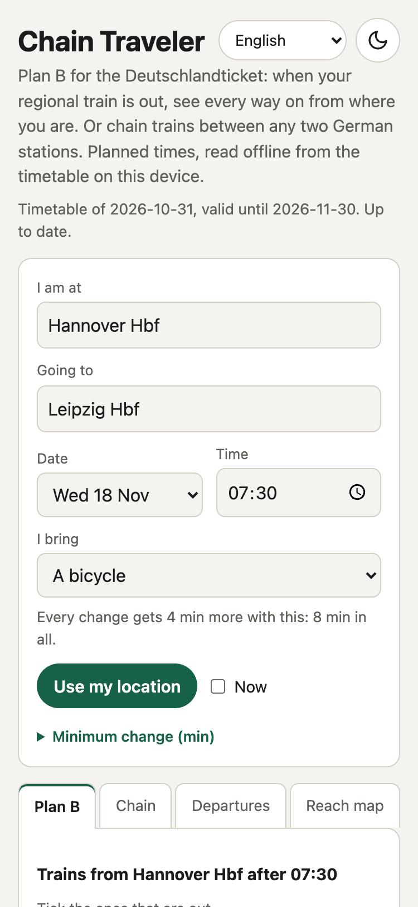
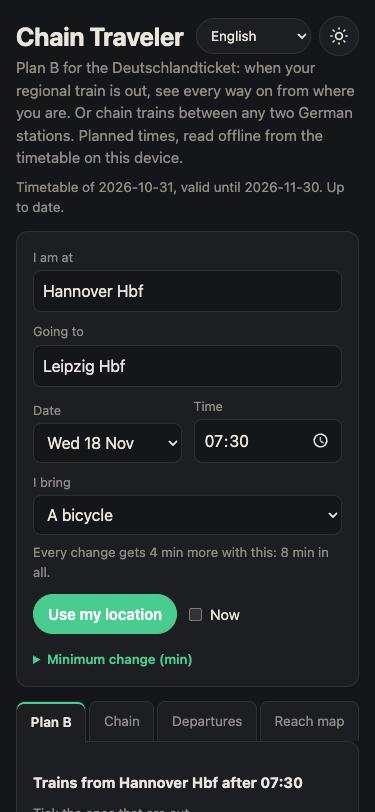
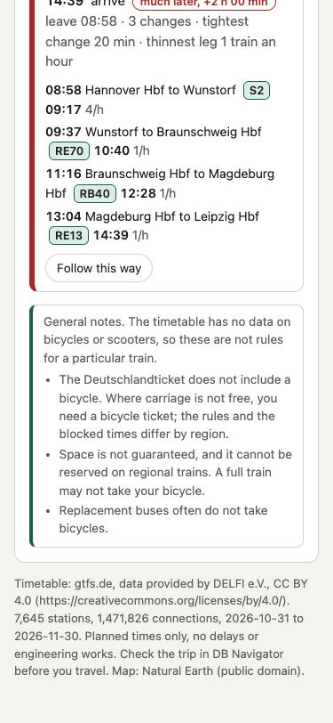
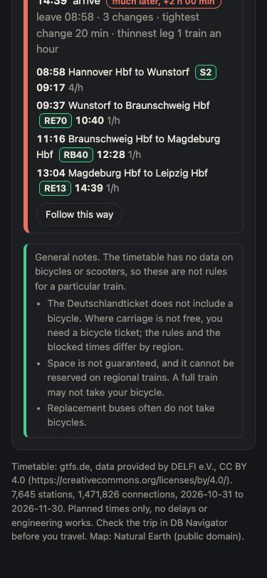
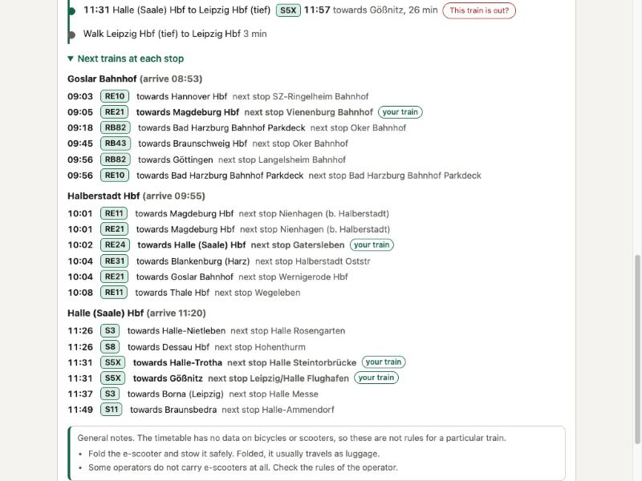
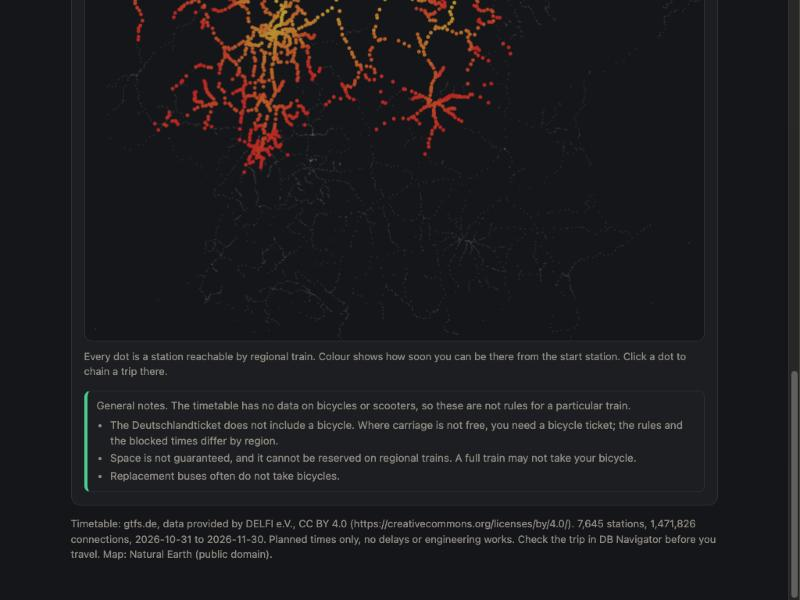

# Travelling with a bicycle or a scooter

Chain Traveler has one setting for what you bring: **nothing** (the default), **a bicycle**, **a folding bicycle**, or **an
e-scooter**. It is the "I bring" box in the bar above the tabs, one tap on a phone. The choice is kept on the device
(`ct-bring` in local storage, with the language and the theme), is never sent anywhere, and is there again after a reload. This is
version 0. It changes how much time a change gets and shows general notes. It does not know which train carries what.

## What it does

1. **Longer changes.** The setting adds minutes to the minimum change, in every place the timetable is scanned: the chain, the
   reach map, Plan B (the ways on and the network around them), and Navigate (recalculations and the ways around the route). The
   box "Minimum change" keeps its meaning and the setting comes on top of it, so a change of 4 minutes with a bicycle is 8.
   The line under the box says it: "Every change gets 4 min more with this: 8 min in all."
2. **General notes.** With something brought, a short note sits under the results (the chain, Plan B, the departures, the reach
   map, and the Navigate card). It is guidance, not a rule for a train, and it says so. With nothing brought there is no note,
   and every result is the one of before the setting existed.
3. **The mark "tight change" moves with it.** A change is marked tight when it is within 2 minutes of the minimum, so with a
   bicycle (4 in the box and 4 more) it is tight up to 10 minutes, where it was tight up to 6.

| I bring | Extra minutes per change |
|---|---|
| Nothing | 0 |
| A bicycle | 4 |
| A folding bicycle | 2 |
| An e-scooter | 2 |

**The owner set these numbers on 2026-11-22**, keeping the first values of the brief. They are a chosen margin, not
measured times. They are four named constants in one place
([`app/bring.js`](../app/bring.js): `NOTHING_EXTRA_MIN`, `BICYCLE_EXTRA_MIN`, `FOLDING_EXTRA_MIN`, `SCOOTER_EXTRA_MIN`).
The line under the box reports what the app does with them, not a measured time. Changing them is a change of those
four constants and nothing else.

## What it does not do yet

- **No train is hidden, marked, or struck through.** The timetable has no bicycle data: the feed has no `bikes_allowed` column
  (`trips.txt` holds `route_id`, `service_id`, and `trip_id`, and every route is rail). So the app cannot say which train takes a
  bicycle, and it does not pretend to.
- **No rule per operator, line, region, or hour.** A bicycle ban at rush hour, a bicycle ticket that is free in one region and not
  in the next, a line that asks for a reservation in summer: none of it is in v0.
- **A walk between two stations gets no extra time.** The scan adds nothing to a change that is a footpath, as before.
- **The Departures tab has no change time**, so the setting adds nothing there but the note.

## Where the rules will come from (v1)

A curated rules file, by operator, line, region, and time window, written by hand from each operator's own conditions of
carriage and shipped with the daily timetable build and hash-verified like the timetable. Every rule names its source
and the day it was checked. A train with no rule shows as **unknown**, never as a guess. v1 covers a first set of regions;
v2 covers the whole feed and publishes the list of what is still unknown. Which regions come first, how much extra time each item
gets, and whether a banned train is hidden or struck through are open decisions of the owner.

## The notes, and what they rest on

Each sentence was checked on 2026-11-18 against the pages below, read in German. Where a page said less than the first wording,
the wording was cut to match it: "does not usually include" became "does not include", and "usually" became "often" for
replacement buses.

| Note (English) | What the sources say | Sources |
|---|---|---|
| The Deutschlandticket does not include a bicycle. Where carriage is not free, you need a bicycle ticket; the rules and the blocked times differ by region. | Carriage of a bicycle is not in the price of the Deutschland-Ticket ("nicht enthalten"). The tariff rules of the federal states, the transport associations, and the operators apply. Check whether carriage is free on your route; where a bicycle ticket is required, it is required with the Deutschland-Ticket too; mind regional blocked times. Per region the page lists free carriage at some hours (Baden-Württemberg, Rhineland-Palatinate, Saarland, Hamburg's rapid transit), free carriage within capacity (Saxony-Anhalt), and an extra ticket as the rule (North Rhine-Westphalia, and always inside the hvv for regional trains). | [1], [2], [3] |
| Space is not guaranteed, and it cannot be reserved on regional trains. A full train may not take your bicycle. | There is no space reservation for bicycles in regional transport. Carriage depends on capacity, and DB cannot guarantee it ("Mitnahmegarantie"); trains on busy and tourist routes can be full at weekends and in summer. | [2], [3], [4] |
| Replacement buses often do not take bicycles. | In replacement transport, local rules apply and carriage is often excluded ("häufig ... ausgeschlossen"). | [2] |
| A folding bicycle, folded, usually travels as luggage, without a bicycle ticket. Stow it so that aisles and doors stay clear. | A folded folding bicycle can be taken free as hand luggage, with no bicycle ticket and no space reservation. It goes in luggage racks or multipurpose areas; aisles, doors, and safety equipment stay free. The luggage page says its tips are written for long-distance trains and apply by analogy to regional transport ("sinngemäß"); the regional bicycle ticket page repeats that a folded folding bicycle can be stowed like luggage. | [4], [5], [6] |
| Fold the e-scooter and stow it safely. Folded, it usually travels as luggage. | A folded e-scooter is hand luggage and must be stowed safely. DB's own e-scooter page is written for long-distance trains; the luggage page applies its tips to regional transport by analogy. The hvv carries folded e-tretroller as hand luggage in the S-Bahn, the AKN, and buses; agilis carries them folded, within the space there is. | [6], [7], [8], [9] |
| Some operators do not carry e-scooters at all. Check the rules of the operator. | The hvv does not allow e-tretroller in its U-Bahn. The transport association Bremen/Niedersachsen excluded them from buses and trams from 1 June 2024. The ADAC lists more operators with a ban (secondary source, a pointer and not a proof). | [8], [10], [11] |

Sources (all read on 2026-11-18):

1. Deutsche Bahn, "Ich will ein Fahrrad mit dem Deutschland-Ticket mitnehmen. Was muss ich beachten?" (help page), <https://www.bahn.de/faq/deutschlandticket-fahrrad>
2. Deutsche Bahn, "Fahrradkarten im Nahverkehr", <https://www.bahn.de/service/individuelle-reise/fahrrad/rad-nahverkehr>
3. Deutsche Bahn, "Fahrradtageskarte des Deutschlandtarifs", <https://www.bahn.de/angebot/zusatzticket/fahrrad/tageskarte-nahverkehr>
4. Deutsche Bahn, "Fahrrad im Nahverkehr: Fragen und Antworten", <https://www.bahn.de/faq/pk/service/individuelle-reise/fahrrad/fahrrad-nv>
5. Deutsche Bahn, "Was muss ich bei der Mitnahme von Falträdern beachten?", <https://www.bahn.de/faq/16was-muss-ich-bei-der-mitnahme-von-faltraedern-beachten>
6. Deutsche Bahn, "Informationen zur Mitnahme von Gepäck im Zug", <https://www.bahn.de/service/zug/gepaeck>
7. Deutsche Bahn, "Was muss ich bei der Mitnahme meines E-Tretrollers/E-Scooter beachten?", <https://www.bahn.de/faq/15was-muss-ich-bei-der-mitnahme-meines-e-tretrollers-oder-e-scooter-beachten>
8. hvv, "Scooter" (questions and answers), <https://www.hvv.de/de/service/fragen-und-antworten/scooter>
9. agilis, "Fahrradmitnahme", <https://www.agilis.de/fahrradmitnahme/>
10. evb Elbe-Weser, "E-Scooter in Bussen ab dem 01.06. ausgeschlossen" (passes on the notice of the Verkehrsverbund Bremen/Niedersachsen), <https://www.evb-elbe-weser.de/e-scooter-in-bussen-ab-dem-01-06-ausgeschlossen/>
11. ADAC, "E-Scooter im Nahverkehr: Verbot im ÖPNV" (17 November 2025, secondary), <https://www.adac.de/news/verkehr-e-scooter-mitnahmeverbot-nahverkehr/>

These pages change. Read them again before any note is changed and before the rules file of v1 is started. What is not checked: no source was found that names every operator in the feed, which is why the notes say "often", "usually", and
"some". Pages of the transport associations and operators change, and carriage rules differ for each of them; the note under a
result is a reason to look at the operator's own page, not a replacement for it. One page of the list shows two prices for the
same day ticket (7.50 and 6.50 euros); the notes do not give a price.

## Languages

The new strings are in English and in all the languages of the app (`app/locales/`). The app has no German version. **The
translations are machine-made and have not been read by native speakers**; a voice pass per language is a later step, as for the
rest of the app.

## What it looks like

A phone, light and dark (the bar with the box and the line under it; the notes under the results):

A desktop, light and dark (the notes for an e-scooter under a chain; the notes for a bicycle under the reach map):

